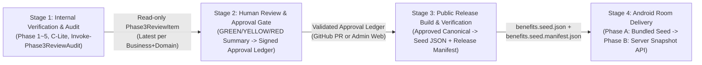

# Approval-to-Public-Release Data Distribution Flow Design (v0.2)

- **Status:** Approved for Implementation (v0.2)
- **Date:** 2026-11-19
- **Baseline:** `dev@5b181f10a5ecd4121a2454cc9bb2f264d76663a7` (post PR 0 / [#154](https://github.com/jelleoo/MILIMAP/pull/154))
- **Issue:** [#151](https://github.com/jelleoo/MILIMAP/issues/151)
- **Scope:** Design specification only (no production code, data, canonical CSV, seed JSON, or Room schema changes)

---

## 1. Problem & Current Baseline

MILIMAP now has an end-to-end internal verification core and immutable History pipeline under `tools/data/`:

- **Phase 1 & 2:** Provider-neutral POI verification (`invoke-phase1-poi-shadow-mode.ps1`) and Benefit verification across HTML tables, MMA JSONP, XLSX, and bounded HWPX/PDF (`invoke-phase2-benefit-shadow-mode.ps1`).
- **Phase 3:** Immutable file-based History Store, writer-lock serialization, optimistic CAS, 4-layer fingerprints (`I-E-S-X`), incremental reuse (`benefit-incremental-reuse.ps1`), and read-only audit/review projection (`invoke-phase3-review-audit.ps1`, emitting `Phase3ReviewItem` with `ReviewRoute`).
- **Phase 4 (Partial):** Native HWPX (`P4-1`) and PdfPig native PDF (`P4-2B`) within bounded limits; scanned Korean OCR (`Issue #125`) remains blocked (`Phase4=NOT_COMPLETE`, `P4-3B=BLOCKED`, `OCR dependency=NOT_APPROVED`).
- **Phase 5 & C-Lite (PR 1 ~ PR 3B):** Single-business cycle (`invoke-phase5-benefit-cycle.ps1`), bounded 10-business batch (`invoke-phase5-benefit-batch.ps1`), read-only Inspector (`inspect-phase5-benefit-batch.ps1`), strict network budget (`P5-2B` + `.NET 10.0.14`), and opt-in `C_LITE_V1` HTML capture + v2 reuse wiring (`benefit-scoped-html-history.ps1`, wired opt-in via PR #150 while default retention remains `'LEGACY'`).
- **Android XML Compatibility Fix (PR 0):** Replaced Apache-only `disallow-doctype-decl` feature with `xmlReader` + `DefaultHandler2` (`startDTD` + `resolveEntity`) in `BenefitXmlParser` (Issue [#153](https://github.com/jelleoo/MILIMAP/issues/153) / PR [#154](https://github.com/jelleoo/MILIMAP/pull/154), merged into `dev`).

However, **the internal verification outputs and the public Android release pipeline are not yet connected through an explicit review-and-approval workflow**:

1. **Internal verification stays internal:** `ProductionAction` is always `NONE`. `Invoke-Phase5BenefitCycle` / `Invoke-Phase5BenefitBatch` write run artifacts to an external History Store and cycle/batch JSON summaries outside the Git repository, never updating `data/canonical/`, `data/seed/`, or `apps/android/`.
2. **Public release generation is currently static-report bound:**
   - `tools/data/convert-benefits.ps1` converts `data/canonical/capital-area-military-benefits.csv` (`496` rows) into pre-release intermediate JSON with deterministic IDs (`Get-StableSeedId`: `"seed-" + sha256("<name>|<address>")[0..11]`) while preserving detailed `district` labels from `apps/android/app/src/main/assets/benefits.seed.json`.
   - `tools/data/build-official-benefit-release-candidates.ps1` joins canonical rows with regional comparison CSVs to produce release candidates (`혜택근거상태 = '공식 최신 근거 확인'`).
   - `tools/data/build-release-benefit-seed.ps1` filters those candidates using `CoordinateReviewCsv` (`감사판정 = '확인 후보'`) and canonical `좌표검증상태 = '확인 완료'` to generate `apps/android/app/src/main/assets/benefits.seed.json` (`249` `ACTIVE` release items: `111` with verified `(latitude, longitude)`, `138` with `(null, null)` map-pin suppression; `247` canonical rows held).
   - `tools/data/test-release-artifact-pipeline.ps1` asserts byte-normalized parity between the regenerated release seed (`249` items, `111` pins) and the committed `benefits.seed.json`.
3. **Android Room synchronization relies on bundled seed version increments and a hardcoded count:**
   - `apps/android/app/src/main/java/com/example/milipercent/MainActivity.kt` wires `BundledSeedSynchronizer`, `LegacyBenefitSeedLoader` (`benefits.seed.json`), `ManualBenefitSeedLoader` (`manual_benefits_seed.json`), and `BenefitDatabase` (Room schema `v4`).
   - `apps/android/app/src/main/java/com/example/milipercent/data/seed/BundledSeedSynchronizer.kt` checks `BUNDLED_SEED_VERSION = 7` and hardcodes `BUNDLED_SEED_EXPECTED_COUNT = 249`.

**Goal:** Specify a safe, auditable 4-stage pipeline from Phase 1~5 / C-Lite verification outputs through human approval into public release assets and Android Room delivery, without weakening existing Fail-Closed boundaries or guessing undecided server infrastructure.

---

## 2. Non-Negotiable Safety & Separation Rules

All stages in this flow MUST preserve MILIMAP's existing safety contracts ([docs/data-policy.md](../../data-policy.md), [docs/architecture.md](../../architecture.md), [tools/data/README.md](../../../tools/data/README.md)):

1. **Strict Two-Zone Data Separation:**
   - *Internal Verification / Review Zone* (`tools/data/`, History Store, external review reports): stores `GREEN` / `YELLOW` / `RED` evaluations, `Phase3ReviewItem`, source provenance, and failure diagnostics.
   - *Approved Public Release Zone* (`data/canonical/`, release seed JSON, release manifest JSON, Android `BenefitEntity` Room table): receives updates **only** after explicit human approval.
2. **Separation of Verification Axes:**
   - **Business Identity** != **Location Verification** != **Benefit Verification**.
   - Validating a Naver Map POI never approves a benefit; confirming an official benefit row never authorizes map coordinates (`좌표검증상태 == '확인 완료'` AND strict single coordinate review `'확인 후보'` required for map pins, otherwise `latitude = null, longitude = null` -> UI renders `위치 확인 필요 · 지도 핀 미표시`).
3. **No Auto-Publish from `GREEN`, No Auto-`ENDED` from `NOT_FOUND` or Errors:**
   - `GREEN` / `RECORD_ONLY` is a fast-review candidate only; human approval is mandatory before public release artifacts change.
   - HTTP/fetch failures, parser failures, `OUTCOME_ONLY`, and `NOT_FOUND` never automatically flip a benefit to `ENDED` or delete a previously published benefit without explicit human review and strong official ending evidence.
4. **Preserved Operational Gate Flags (Unchanged by This Design):**
   - `ProductionAction=NONE`
   - `LiveHTTP=NOT_AUTHORIZED` (`Issue #134`)
   - `C-Lite activation=NOT_AUTHORIZED`
   - `RAW suppression=NOT_AUTHORIZED`
   - `P4-3B=BLOCKED`, `OCR dependency=NOT_APPROVED`, `Phase4=NOT_COMPLETE` (`Issue #125`)
5. **Android Room SSOT & User Data Preservation:**
   - `BenefitDatabase` remains schema `v4` (`Room` SSOT; `Repository -> ViewModel -> UiState -> Compose`).
   - Any bundled or future remote seed replacement applies only to `LOCAL_GOV`, `MANUAL_SEED`, and `PUBLIC_EVIDENCE` rows while preserving `FavoriteEntity` (via stable `seed-<sha256[0..11]>` IDs), local user accounts, and `MMA_API` reconciliation (`BenefitReconciler.kt`).

---

## 3. 4-Stage Target Flow (v0.2 MVP -> Post-MVP Expansion)



### Stage 1: Internal Verification -> Read-Only Review Queue Summary

* **Producer:** Existing Phase 1~5 pipelines scanned read-only via `Invoke-Phase3ReviewAudit`.
* **Latest-Observation Selection Rule:**
  - By default, select ONLY the **latest committed observation per `(BusinessId, Domain)`** ordered by `ObservedAt` UTC instant and ordinal `ObservationId` (matching `Rebuild-HistoryIndexes`).
  - Provide an explicit `-IncludeSuperseded` opt-in switch when historical audit exports are needed.
* **Verified Projection Hydration (Zero RAW Leakage):**
  - Read committed `HistoryObservation` and verify structured projections ONLY via existing read-only projection readers:
    - `BENEFIT`: `Read-BenefitHistorySemanticProjection` (for `BenefitState`, `ReviewClass`, `BusinessPresence`, `AbsenceEligible`, material claims/reasons) and fingerprint-verified `BENEFIT_EVIDENCE_PROJECTION` (extracting ONLY `SourceUrls`, `SourceFormats`, `SourceContentHashes`, `LocationStatuses`).
    - `LOCATION`: `Read-LocationHistorySemanticProjection` (for `EvaluationStatus`, `Classification`, `SelectionStatus`, `SelectedLocation`, `MaterialReasonCodes`, `ConflictCodes`).
  - **Strictly forbidden:** never read, hydrate, or emit `RAW_SOURCE_PAYLOAD` or `BENEFIT_SCOPED_EVIDENCE` HTML snippets into summary JSON or CSV exports.
  - Fail closed on any semantic or evidence projection hash/fingerprint mismatch; if a bare observation has no semantic projection reference, route to `DIAGNOSTIC_HOLD` with `SEMANTIC_PROJECTION_UNAVAILABLE`.
* **Exhaustive, Mutually Exclusive 3-Bucket `OperatorBucket` Partition:**
  1. **`DIAGNOSTIC_HOLD`:** Any item where `ReviewRoute` is `AUDIT_VERIFICATION` or `OPERATIONAL_DIAGNOSTIC`, OR `CurrentOperationalStatus != 'COMPLETE'`, OR `CurrentComparable == false`, OR canonical row lookup fails (`CANONICAL_ROW_MISSING`), OR semantic projection is unavailable. Excluded from benefit release decisions and routed to engineering diagnostics.
  2. **`FAST_REVIEW`:** Not `DIAGNOSTIC_HOLD`, AND `ReviewRoute == 'RECORD_ONLY'`, AND (`BENEFIT`: `ReviewClass == 'GREEN'` & `BenefitState == 'ACTIVE'`, OR `LOCATION`: `Classification == 'GREEN'`). Confirmed unchanged or re-verified official/POI evidence eligible for bulk human review (`ProductionAction = 'NONE'`, `ApprovalRequired = true`).
  3. **`DOMAIN_REVIEW`:** All remaining operationally `COMPLETE` & comparable items (covers `HUMAN_DOMAIN_REVIEW`, `YELLOW`/`RED`, `NEEDS_VERIFICATION`/`ENDED`, and unchanged unresolved rows). Requires side-by-side canonical vs. official evidence inspection before approve/hold/retire decision.
* **External Output Hygiene:** Write atomically (`review-queue-summary.json` UTF-8 without BOM + `review-queue-items.csv`) strictly outside ALL Git repository roots, non-overlapping with the History Store root (bidirectional prefix check), and free of reparse points.

### Stage 2: Human Approval Gate & Approval Record Contract

Two progressive operational paths (starting with Option A, keeping the approval ledger format identical so Option B adopts it cleanly):

* **Option A (Current MVP — PR-Based Governance):** Developer/owner reviews the Stage 1 summary externally, records validated human decisions in `BenefitReleaseApprovalLedger` (v1), updates `data/canonical/capital-area-military-benefits.csv` and/or review CSVs in a release Data PR per [docs/data-policy.md](../../data-policy.md) rules, and merges after CI + human review.
* **Option B (Future — Admin Web MVP + Backend API, `Pending`):** Admin web displays the same Stage 1 diff cards (`existing canonical` vs `observed official evidence` + `Coordinate` status) and records operator decisions (`APPROVE_ACTIVE`, `HOLD_NEEDS_VERIFICATION`, `APPROVE_ENDED`) into central storage (`services/api`, `Pending`).

#### `BenefitReleaseApprovalRecord` (v1 Contract)

Each record in `BenefitReleaseApprovalLedger` (`ContractType = 'BenefitReleaseApprovalLedger'`, `ContractVersion = 1`) captures one human release decision keyed by `businessId`:

```text
BenefitReleaseApprovalRecord (v1):
- businessId: string ("biz-<32hex>", primary key, unique per ledger)
- canonicalRowNumber: int? (optional; when present must match exact Canonical CSV row)
- reviewKey: string (ComparisonId or ObservationId from Phase3ReviewItem)
- targetRunId: string (RunId of committed BENEFIT observation)
- observationId: string (ObservationId of committed BENEFIT observation)
- locationObservationId: string? (optional; committed LOCATION observation on separate axis)
- benefitDecision: enum (APPROVE_ACTIVE | HOLD_NEEDS_VERIFICATION | APPROVE_ENDED)
- coordinateDecision: enum (KEEP_PIN | SUPPRESS_PIN)
- verifiedSourceUrl: string (" | "-separated http(s) URL list)
- verifiedOn: string (real calendar YYYY-MM-DD)
- approvedBy: string (human reviewer handle/id; rejects AUTO/SYSTEM/BOT/UNKNOWN/NONE)
- approvedAt: string (ISO-8601 timestamp with explicit Z or [+-]HH:MM offset)
- rationale: string (mandatory when benefitDecision == APPROVE_ENDED or overriding non-GREEN)
```

* **Fail-Closed Ledger Validation Rules (`validate-benefit-release-approvals.ps1`):**
  - Duplicate `businessId`, unknown `businessId`, or `canonicalRowNumber` mismatch with Canonical CSV -> reject.
  - `(observationId, targetRunId, reviewKey, businessId)` must match an exact committed `BENEFIT` item returned read-only by `Invoke-Phase3ReviewAudit` -> reject uncommitted/aborted/mismatched records.
  - `APPROVE_ACTIVE`: requires `OperationalStatus == 'COMPLETE'` and `Comparable == true`; loads verified `BENEFIT_SEMANTIC_PROJECTION` and requires non-blank `rationale` whenever `ReviewClass != 'GREEN'`; requires valid `verifiedSourceUrl` & `verifiedOn`.
  - `APPROVE_ENDED`: requires non-blank `rationale`, valid `verifiedSourceUrl`, and `coordinateDecision == 'SUPPRESS_PIN'` (excluded from active release seed).
  - `KEEP_PIN`: requires canonical `좌표검증상태 == '확인 완료'`, valid Korea WGS84 `(위도, 경도)` (`33..39`, `124..132`), AND an exact single `'확인 후보'` match in `CoordinateReviewCsv` with matching normalized name and road address.
  - Optional `locationObservationId`: verified read-only against a committed `LOCATION` observation for the same `businessId` (`COMPLETE` & `Comparable == true`).

### Stage 3: Public Release Seed & Manifest Generation

Once human approvals are committed for a release cut:

1. **Pre-Release Conversion (`convert-benefits.ps1`):** Preserves deterministic `seed-<sha256[0..11]>` business IDs and existing district strings via `-DistrictReferenceJson` so Android users' saved `FavoriteEntity` rows remain linked across seed releases.
2. **Release Candidate & Coordinate Policy (`build-official-benefit-release-candidates.ps1` -> `build-release-benefit-seed.ps1`):**
   - Emits **only** approved `ACTIVE` release items into the public artifact (`benefits.seed.json`), stripping internal `HOLD` / diagnostic rows and nullifying `(latitude, longitude)` unless both canonical `확인 완료` and strict POI audit `확인 후보` hold.
   - Bumps `BUNDLED_SEED_VERSION` (currently `7`) strictly when `benefits.seed.json` content changes. For the unchanged 249-row baseline asset, `seedVersion` stays `7`.
3. **Cross-Platform Hash & Public Release Manifest (`benefits.seed.manifest.json`, v1):**
   - Standardize **`hashAlgorithm = "SHA-256-LF-UTF8"`**: strip optional leading UTF-8 BOM (`\uFEFF`), normalize `\r\n` and `\r` to `\n`, hash raw UTF-8 bytes without BOM as lowercase 64-hex SHA-256. This guarantees byte-identical digests across Windows CRLF checkouts (`* text=auto`), Ubuntu CI LF checkouts, and Android packaged APK assets.
   - Replace shallow-clone-fragile git commit SHAs with deterministic **`canonicalCsvSha256`** computed over `data/canonical/capital-area-military-benefits.csv`.
   - Include **`manualSeedCount`** (`0`) and **`manualSeedSha256`** alongside `totalCount`, `exactPinCount`, `unconfirmedCoordinateCount`, and `seedSha256`:
     ```json
     {
       "manifestVersion": 1,
       "seedName": "benefits",
       "seedVersion": 7,
       "hashAlgorithm": "SHA-256-LF-UTF8",
       "generatedAt": "2026-09-10T00:00:00+09:00",
       "canonicalCsvSha256": "<64-hex>",
       "totalCount": 249,
       "exactPinCount": 111,
       "unconfirmedCoordinateCount": 138,
       "seedSha256": "<64-hex>",
       "manualSeedCount": 0,
       "manualSeedSha256": "<64-hex>"
     }
     ```
   - Manifest invariants enforced at both build time (`build-release-benefit-seed-manifest.ps1`) and Android startup: `manifestVersion == 1`, `seedName == "benefits"`, `seedVersion >= 1`, `hashAlgorithm == "SHA-256-LF-UTF8"`, `totalCount >= 1`, `exactPinCount >= 0`, `unconfirmedCoordinateCount >= 0`, `exactPinCount + unconfirmedCoordinateCount == totalCount`, `manualSeedCount >= 0`, valid `generatedAt` ISO-8601 with offset, and three 64-hex SHA-256 digests.
4. **Release Parity Gate:** Extend `test-release-artifact-pipeline.ps1` so CI verifies count, pin count, manual count, and `SHA-256-LF-UTF8` hash parity between generated/canonical assets and committed `apps/android/app/src/main/assets/benefits.seed.manifest.json`.

### Stage 4: Android Room Delivery

* **Phase A (Immediate MVP — Manifest-Driven Bundled Asset Sync into Room v4):**
  1. `BundledSeedManifestLoader` loads and validates `benefits.seed.manifest.json` using pure Kotlin calendar/offset checks (no `java.time.*`, preserving `minSdk = 24` without desugaring).
  2. `BundledSeedSynchronizer` reads BOTH `benefits.seed.json` and `manual_benefits_seed.json` once in memory and verifies before entering `database.withTransaction`:
     - `sha256LfUtf8(legacyRawText) == manifest.seedSha256`
     - `sha256LfUtf8(manualRawText) == manifest.manualSeedSha256`
     - Schema/field validation via `LegacyBenefitSeedLoader` and `ManualBenefitSeedLoader`
     - `legacyEntities.size == manifest.totalCount`, `exactPinCount`, `unconfirmedCoordinateCount`
     - `manualEntities.size == manifest.manualSeedCount`
     - Combined ID uniqueness and normalized `(name, address)` duplicate checks
  3. Inside the transaction, using an internal `BundledSeedStore` abstraction (preserving `BenefitDatabase` schema `v4` and allowing pure JVM unit testing):
     - Skip safely with `installed = false` if `installedVersion != null && installedVersion >= manifest.seedVersion` (idempotent + downgrade-safe).
     - Otherwise delete retired `LOCAL_GOV` / `MANUAL_SEED` / `PUBLIC_EVIDENCE` rows (`sourceRowNumber IS NULL`), upsert validated entities, verify post-upsert stored bundled count equals `manifest.totalCount + manifest.manualSeedCount`, and record `SeedStateEntity(name = manifest.seedName, version = manifest.seedVersion)`.
* **Phase B (Future Expansion — Read-Only Remote Snapshot Sync, `Pending`):**
  1. Once `services/api` and `packages/contracts` are designed and approved, Android checks a read-only public endpoint serving `{ seedVersion, manifest, publicSeedUrl / payload }` using ETag / `seedSha256` conditional fetch.
  2. Downloaded items pass the **exact same pre-transaction manifest + checksum validation** and downgrade-safe write into existing Room `v4` without requiring an APK update when official discounts change.
  3. On network error, schema mismatch, or hash mismatch, Android fails closed and retains the last good Room cache.

---

## 4. Direct Codebase Gaps Addressed by This Plan

1. **Hardcoded `249` Expected Count in Android Sync ([`BundledSeedSynchronizer.kt`](../../../apps/android/app/src/main/java/com/example/milipercent/data/seed/BundledSeedSynchronizer.kt)):**
   - Remove compile-time `BUNDLED_SEED_EXPECTED_COUNT = 249` and replace with `benefits.seed.manifest.json` count + `SHA-256-LF-UTF8` checksum verification while keeping `BenefitDatabase` schema `v4` unchanged (`PR 3`).
2. **Dated Regional Report Paths in Release Candidate & Parity Scripts ([`build-official-benefit-release-candidates.ps1`](../../../tools/data/build-official-benefit-release-candidates.ps1), [`test-release-artifact-pipeline.ps1`](../../../tools/data/test-release-artifact-pipeline.ps1)):**
   - Add `BenefitReleaseApprovalLedger` validation + `build-release-benefit-seed-manifest.ps1` and extend `test-release-artifact-pipeline.ps1` without breaking existing 2026-09 parity assertions (`PR 2`).
3. **No Read-Only Operator Review Summary Exporter Yet:**
   - Add `tools/data/export-phase5-review-queue.ps1` exporting `DIAGNOSTIC_HOLD` / `FAST_REVIEW` / `DOMAIN_REVIEW` operator queues outside the repo with zero RAW HTML leakage (`PR 1`).
4. **Android XML Parser DOCTYPE Compatibility Fix (Resolved in PR 0):**
   - Resolved via Issue [#153](https://github.com/jelleoo/MILIMAP/issues/153) / PR [#154](https://github.com/jelleoo/MILIMAP/pull/154).

---

## 5. Explicitly Pending / Undecided Decisions

Per [docs/architecture.md](../../architecture.md) and [docs/ai-development.md](../../ai-development.md), this spec intentionally leaves the following `Pending` until dedicated ADRs / owner approvals:

- Backend framework, hosting platform, and central database product (PostgreSQL/PostGIS vs. alternatives)
- Admin authentication/authorization mechanism and Role-Based Access Control
- Final HTTP API contract (`packages/contracts`, `services/api`) for public feed & admin portal
- Periodic background scheduler / cron runner host environment
- Official site automated HTTP clearance (`Issue #134`, `LiveHTTP=NOT_AUTHORIZED`)
- Runtime activation of `C_LITE_V1` (`Get-InternalPhase5HtmlEvidenceRetentionProfile`) and default HTML RAW suppression
- Phase 4 scanned PDF Korean OCR resolution (`Issue #125`, `OCR dependency=NOT_APPROVED`)

---

## 6. Approved Small-PR Implementation Sequence

| Order | Scope | Files / Area | Status / Gate |
| :--- | :--- | :--- | :--- |
| **PR 0** | Android `BenefitXmlParser` DOCTYPE/runtime compatibility fix | `apps/android/.../BenefitXmlParser.kt`, `BenefitXmlParserTest.kt` | **Merged** ([#153](https://github.com/jelleoo/MILIMAP/issues/153) / [#154](https://github.com/jelleoo/MILIMAP/pull/154)) |
| **Design** | Approval-to-Public-Release Data Distribution Flow Design v0.2 | `docs/superpowers/specs/2026-11-19-approval-to-public-release-data-flow-design.md` | **Ready to merge** ([#151](https://github.com/jelleoo/MILIMAP/issues/151) / [#152](https://github.com/jelleoo/MILIMAP/pull/152)) |
| **PR 1** | **Read-Only Review Queue Summary Exporter** over committed History (external output only; zero RAW HTML; `ProductionAction=NONE`) | `tools/data/export-phase5-review-queue.ps1`, `test-export-phase5-review-queue.ps1`, `tools/data/README.md` | Follows Design v0.2 merge |
| **PR 2** | **Approval Ledger Validator & Release Seed Manifest Builder** (`benefits.seed.manifest.json` generator + fail-closed ledger validator + parity extension) | `tools/data/lib/release/approval-release-contracts.ps1`, `validate-benefit-release-approvals.ps1`, `build-release-benefit-seed-manifest.ps1`, `test-approval-release-pipeline.ps1`, `test-release-artifact-pipeline.ps1`, `apps/android/app/src/main/assets/benefits.seed.manifest.json`, `tools/data/README.md` | Follows PR 1 merge |
| **PR 3** | **Manifest-Driven `BundledSeedSynchronizer`** removing hardcoded `BUNDLED_SEED_EXPECTED_COUNT = 249` (Room `v4` unchanged) | `apps/android/.../data/seed/BundledSeedManifest.kt`, `BundledSeedSynchronizer.kt`, `MainActivity.kt`, unit & androidTest files | Follows PR 2 merge |
| **PR 4+** | **Release Data Cut PRs** & subsequent **Admin Web / Shared API ADR** (`services/api`, `packages/contracts`, Phase B remote snapshot sync) | Dedicated Issue/ADR per track | Future post-MVP work |
