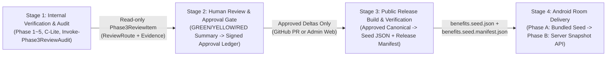

# Approval-to-Public-Release Data Distribution Flow Design (v0.1)

- **Status:** Draft (awaiting owner design review)
- **Date:** 2026-11-19
- **Baseline:** `dev@2d246d973334d197348af09982de3076b3c2f0eb`
- **Issue:** [#151](https://github.com/jelleoo/MILIMAP/issues/151)
- **Scope:** Design specification only (no production code, data, canonical CSV, seed JSON, or Room schema changes)

---

## 1. Problem & Current Baseline

MILIMAP now has an end-to-end internal verification core and immutable History pipeline under `tools/data/`:

- **Phase 1 & 2:** Provider-neutral POI verification (`invoke-phase1-poi-shadow-mode.ps1`) and Benefit verification across HTML tables, MMA JSONP, XLSX, and bounded HWPX/PDF (`invoke-phase2-benefit-shadow-mode.ps1`).
- **Phase 3:** Immutable file-based History Store, writer-lock serialization, optimistic CAS, 4-layer fingerprints (`I-E-S-X`), incremental reuse (`benefit-incremental-reuse.ps1`), and read-only audit/review projection (`invoke-phase3-review-audit.ps1`, emitting `Phase3ReviewItem` with `ReviewRoute`).
- **Phase 4 (Partial):** Native HWPX (`P4-1`) and PdfPig native PDF (`P4-2B`) within bounded limits; scanned Korean OCR (`Issue #125`) remains blocked (`Phase4=NOT_COMPLETE`, `P4-3B=BLOCKED`, `OCR dependency=NOT_APPROVED`).
- **Phase 5 & C-Lite (PR 1 ~ PR 3B):** Single-business cycle (`invoke-phase5-benefit-cycle.ps1`), bounded 10-business batch (`invoke-phase5-benefit-batch.ps1`), read-only Inspector (`inspect-phase5-benefit-batch.ps1`), strict network budget (`P5-2B` + `.NET 10.0.14`), and opt-in `C_LITE_V1` HTML capture + v2 reuse wiring (`benefit-scoped-html-history.ps1`, wired opt-in via PR #150 while default retention remains `'LEGACY'`).

However, **the internal verification outputs and the public Android release pipeline are not yet connected through an explicit review-and-approval workflow**:

1. **Internal verification stays internal:** `ProductionAction` is always `NONE`. `Invoke-Phase5BenefitCycle` / `Invoke-Phase5BenefitBatch` write run artifacts to an external History Store and cycle/batch JSON summaries outside the Git repository, never updating `data/canonical/`, `data/seed/`, or `apps/android/`.
2. **Public release generation is currently static-report bound:**
   - `tools/data/convert-benefits.ps1` converts `data/canonical/capital-area-military-benefits.csv` (`496` rows) into pre-release intermediate JSON with deterministic IDs (`Get-StableSeedId`: `"seed-" + sha256("<name>|<address>")[0..11]`) while preserving detailed `district` labels from `apps/android/app/src/main/assets/benefits.seed.json`.
   - `tools/data/build-official-benefit-release-candidates.ps1` joins canonical rows with regional comparison CSVs to produce release candidates (`혜택근거상태 = '공식 최신 근거 확인'`).
   - `tools/data/build-release-benefit-seed.ps1` filters those candidates using `CoordinateReviewCsv` (`감사판정 = '확인 후보'`) and canonical `좌표검증상태 = '확인 완료'` to generate `apps/android/app/src/main/assets/benefits.seed.json` (`249` `ACTIVE` release items: `111` with verified `(latitude, longitude)`, `138` with `(null, null)` map-pin suppression; `247` canonical rows held).
   - `tools/data/test-release-artifact-pipeline.ps1` asserts byte-normalized parity between the regenerated release seed (`249` items, `111` pins) and the committed `benefits.seed.json`.
3. **Android Room synchronization relies on bundled seed version increments and a hardcoded count:**
   - `apps/android/app/src/main/java/com/example/milipercent/MainActivity.kt` wires `BundledSeedSynchronizer`, `LegacyBenefitSeedLoader` (`benefits.seed.json`), `ManualBenefitSeedLoader` (`manual_benefits_seed.json`), and `BenefitDatabase` (Room schema `v4`).
   - `apps/android/app/src/main/java/com/example/milipercent/data/seed/BundledSeedSynchronizer.kt` checks `BUNDLED_SEED_VERSION = 7` and hardcodes `BUNDLED_SEED_EXPECTED_COUNT = 249`.

**Goal:** Specify a safe, auditable 4-stage pipeline from Phase 1~5 / C-Lite verification outputs through human approval into public release assets and Android Room delivery, without weakening existing Fail-Closed boundaries or guessing undecided server infrastructure.

---

## 2. Non-Negotiable Safety & Separation Rules

All stages in this flow MUST preserve MILIMAP's existing safety contracts ([docs/data-policy.md](../../data-policy.md), [docs/architecture.md](../../architecture.md), [tools/data/README.md](../../../tools/data/README.md)):

1. **Strict Two-Zone Data Separation:**
   - *Internal Verification / Review Zone* (`tools/data/`, History Store, external review reports): stores `GREEN` / `YELLOW` / `RED` evaluations, `Phase3ReviewItem`, source provenance, and failure diagnostics.
   - *Approved Public Release Zone* (`data/canonical/`, release seed JSON, Android `BenefitEntity` Room table): receives updates **only** after explicit human approval.
2. **Separation of Verification Axes:**
   - **Business Identity** != **Location Verification** != **Benefit Verification**.
   - Validating a Naver Map POI never approves a benefit; confirming an official benefit row never authorizes map coordinates (`좌표검증상태 == '확인 완료'` AND strict coordinate review `'확인 후보'` required for map pins, otherwise `latitude = null, longitude = null` -> UI renders `위치 확인 필요 · 지도 핀 미표시`).
3. **No Auto-Publish from `GREEN`, No Auto-`ENDED` from `NOT_FOUND` or Errors:**
   - `GREEN` / `RECORD_ONLY` is a fast-review candidate only; human approval is mandatory before public release artifacts change.
   - HTTP/fetch failures, parser failures, `OUTCOME_ONLY`, and `NOT_FOUND` never automatically flip a benefit to `ENDED` or delete a previously published benefit without explicit human review and strong official ending evidence.
4. **Preserved Operational Gate Flags (Unchanged by This Design):**
   - `ProductionAction=NONE`
   - `LiveHTTP=NOT_AUTHORIZED` (`Issue #134`)
   - `C-Lite activation=NOT_AUTHORIZED`
   - `RAW suppression=NOT_AUTHORIZED`
   - `P4-3B=BLOCKED`, `OCR dependency=NOT_APPROVED`, `Phase4=NOT_COMPLETE` (`Issue #125`)
5. **Android Room SSOT & User Data Preservation:**
   - `BenefitDatabase` remains schema `v4` (`Room` SSOT; `Repository -> ViewModel -> UiState -> Compose`).
   - Any bundled or future remote seed replacement applies only to `LOCAL_GOV`, `MANUAL_SEED`, and `PUBLIC_EVIDENCE` rows while preserving `FavoriteEntity` (via stable `seed-<sha256[0..11]>` IDs), local user accounts, and `MMA_API` reconciliation (`BenefitReconciler.kt`).

---

## 3. 4-Stage Target Flow (v0.1 MVP -> Post-MVP Expansion)



### Stage 1: Internal Verification -> Read-Only Review Queue Summary

* **Producer:** Existing Phase 1~5 pipelines + `Invoke-Phase3ReviewAudit` (or Phase 5 batch/cycle outputs outside the repo).
* **Deterministic Triage View (Operator Summary):** Export a read-only external operator report (never modifying History Store or `data/`) grouping latest committed `Phase3ReviewItem`s by `ReviewRoute` and `ReviewClass`:
  - **Fast-Review Bucket (`RECORD_ONLY` + `GREEN`):** Confirmed unchanged or re-verified official evidence -> eligible for bulk human sign-off.
  - **Domain Review Bucket (`HUMAN_DOMAIN_REVIEW` + `YELLOW`/`RED`):** `BENEFIT_CHANGE_SUSPECTED`, `BENEFIT_ABSENCE_SUSPECTED`, `LOCATION_CHANGE_SUSPECTED`, `LOCATION_ABSENCE_SUSPECTED` -> requires side-by-side canonical vs. official evidence inspection before approve/hold/retire decision.
  - **Audit & Diagnostic Hold Bucket (`AUDIT_VERIFICATION` / `OPERATIONAL_DIAGNOSTIC`):** `CANONICAL_INPUT_CHANGED`, `PROCESSOR_OUTPUT_CHANGED`, `OPERATIONAL_FAILURE`, `COMPARISON_UNAVAILABLE`, `COMPARISON_NOT_RECORDED` -> excluded from benefit release decisions; routed to engineering diagnostics.
* **Privacy & Storage Hygiene:** Summary rows carry `BusinessId`, `ObservationId`, `ReviewKey`, `ReviewRoute`, `BenefitState`, `ReviewClass`, `ReasonCodes`, source URL/hash, and structured field diffs — **never** full raw HTML or local filesystem secrets.

### Stage 2: Human Approval Gate & Approval Record Contract

Two progressive operational paths (starting with Option A, keeping the approval ledger format identical so Option B adopts it cleanly):

* **Option A (Current MVP — PR-Based Governance):** Developer/owner reviews the Stage 1 summary externally, updates `data/canonical/capital-area-military-benefits.csv` and/or review CSVs in a release Data PR per [docs/data-policy.md](../../data-policy.md) rules, records explicit approval metadata, and merges after CI + human review.
* **Option B (Future — Admin Web MVP + Backend API, `Pending`):** Admin web displays the same Stage 1 diff cards (`existing canonical` vs `observed official evidence` + `Coordinate` status) and records operator decisions (`APPROVE_RELEASE`, `HOLD_NEEDS_VERIFICATION`, `RETIRE_ENDED`) into central storage (`services/api`, `Pending`).

#### Proposed Approval Record Contract (`Pending` Owner Approval)

Before changing production approval scripts, standardize an immutable review-to-release decision record:

```text
BenefitReleaseApprovalRecord (v1, proposed):
- businessId: string ("biz-<32hex>")
- canonicalRowNumber: int
- reviewKey: string (ComparisonId or ObservationId from Phase3ReviewItem)
- targetRunId: string
- observationId: string
- benefitDecision: enum (APPROVE_ACTIVE | HOLD_NEEDS_VERIFICATION | APPROVE_ENDED)
- coordinateDecision: enum (KEEP_PIN | SUPPRESS_PIN)
- verifiedSourceUrl: string
- verifiedOn: YYYY-MM-DD
- approvedBy: string (reviewer handle/id)
- approvedAt: ISO-8601 timestamp with offset
- rationale: string (mandatory when overriding or ending)
```

- **Fail-Closed Rule:** Any `BenefitReleaseApprovalRecord` whose `observationId` / `reviewKey` does not verify read-only against committed History (or whose `coordinateDecision == KEEP_PIN` lacks `좌표검증상태 == '확인 완료'` and `'확인 후보'`) is rejected during Stage 3 build.

### Stage 3: Public Release Seed & Manifest Generation

Once human approvals are committed for a release cut:

1. **Pre-Release Conversion (`convert-benefits.ps1`):** Preserves deterministic `seed-<sha256[0..11]>` business IDs and existing district strings via `-DistrictReferenceJson` so Android users' saved `FavoriteEntity` rows remain linked across seed releases.
2. **Release Candidate & Coordinate Policy (`build-official-benefit-release-candidates.ps1` -> `build-release-benefit-seed.ps1`):**
   - Emits **only** approved `ACTIVE` release items into the public artifact (`benefits.seed.json`), stripping internal `HOLD` / diagnostic rows and nullifying `(latitude, longitude)` unless both canonical `확인 완료` and strict POI audit `확인 후보` hold.
   - Bumps `BUNDLED_SEED_VERSION` (currently `7`) strictly when `benefits.seed.json` content changes.
3. **Proposed Public Release Manifest (`benefits.seed.manifest.json`, `Pending` Approval):**
   - Pair `benefits.seed.json` with a small metadata manifest to remove hardcoded count assumptions:
     ```json
     {
       "manifestVersion": 1,
       "seedName": "benefits",
       "seedVersion": 8,
       "generatedAt": "2026-11-19T00:00:00+09:00",
       "canonicalRevision": "<git-sha>",
       "totalCount": 249,
       "exactPinCount": 111,
       "unconfirmedCoordinateCount": 138,
       "seedSha256": "<64-hex>"
     }
     ```
4. **Release Parity Gate:** Extend `test-release-artifact-pipeline.ps1` so CI verifies count/pin/hash parity between the generated release seed + manifest and the committed Android assets.

### Stage 4: Android Room Delivery

* **Phase A (Immediate MVP — Bundled Asset Sync into Room v4):**
  1. `BundledSeedSynchronizer` reads `benefits.seed.manifest.json` (plus `benefits.seed.json` + `manual_benefits_seed.json`) using `AssetJsonSource`, verifying `manifest.totalCount == entities.size` and SHA-256 integrity **before** starting `database.withTransaction`.
  2. When `seedStateDao.version("benefits") < targetSeedVersion`, `BundledSeedSynchronizer` deletes retired `LOCAL_GOV` / `MANUAL_SEED` / `PUBLIC_EVIDENCE` rows, upserts approved entities, and records the new `SeedStateEntity.version`, leaving `FavoriteEntity`, local user sessions, and `MMA_API` cache intact.
* **Phase B (Future Expansion — Read-Only Remote Snapshot Sync, `Pending`):**
  1. Once `services/api` and `packages/contracts` are designed and approved, Android checks a read-only public endpoint serving `{ seedVersion, manifest, publicSeedUrl / payload }` using ETag / `seedSha256` conditional fetch.
  2. Downloaded items pass the **exact same pre-transaction validation** (`LegacyBenefitSeedLoader` + manifest count/hash checks) and write through `BundledSeedSynchronizer` / `BenefitRepository` into existing Room `v4` without requiring an APK update when official discounts change.
  3. On network error, schema mismatch, or hash mismatch, Android fails closed and retains the last good Room cache.

---

## 4. Direct Codebase Gaps Identified

Inspection of the current `dev` workspace reveals four concrete gaps that subsequent PRs must address:

1. **Hardcoded `249` Expected Count in Android Sync ([`BundledSeedSynchronizer.kt:12`](../../../apps/android/app/src/main/java/com/example/milipercent/data/seed/BundledSeedSynchronizer.kt#L10-L38)):**
   - `BUNDLED_SEED_EXPECTED_COUNT = 249` is a compile-time constant checked both before (`require(entities.size == BUNDLED_SEED_EXPECTED_COUNT)`) and inside (`check(bundledStoredCount == BUNDLED_SEED_EXPECTED_COUNT)`) the Room transaction. Adding or retiring even 1 approved business in a future seed update will crash Android startup sync unless `BundledSeedSynchronizer` reads the expected count dynamically from an accompanying seed manifest (keeping `BenefitDatabase` schema `v4` unchanged).
2. **Dated Regional Report Paths in Release Candidate & Parity Scripts ([`build-official-benefit-release-candidates.ps1`](../../../tools/data/build-official-benefit-release-candidates.ps1), [`test-release-artifact-pipeline.ps1`](../../../tools/data/test-release-artifact-pipeline.ps1)):**
   - Both scripts currently target the three initial regional comparison files (`ddc-benefit-comparison-20260908.csv`, `paju-benefit-comparison-20260906.csv`, `yangju-benefit-comparison-20260906.csv`) and `poi-coordinate-review-candidates-20260910-final.csv`. They need an additive bridge accepting approved Phase 1~5 / review-ledger inputs without breaking existing 2026-09 parity tests until regenerated intentionally.
3. **No Read-Only Operator Review Summary Exporter Yet:**
   - `Invoke-Phase3ReviewAudit` and `Inspect-Phase5BenefitBatch` return in-memory objects and per-batch technical JSONs, but there is not yet a single read-only script exporting human-readable `GREEN` / `YELLOW` / `RED` review queues (outside the repo, zero RAW leakage) ready for Stage 2 approval.
4. **Pending Uncommitted Android XML Parser Fix in Primary Workspace ([`BenefitXmlParser.kt`](../../../apps/android/app/src/main/java/com/example/milipercent/network/BenefitXmlParser.kt), [`BenefitXmlParserTest.kt`](../../../apps/android/app/src/test/java/com/example/milipercent/network/BenefitXmlParserTest.kt)):**
   - Local working tree currently contains an uncommitted fix replacing Apache-only `http://apache.org/xml/features/disallow-doctype-decl` with `DefaultHandler2` (`startDTD` + `resolveEntity` over `xmlReader` + `LEXICAL_HANDLER`), plus updated tests (`RejectingSecurityFeatureSaxParserFactory`). Once verified with `.\gradlew.bat lintDebug testDebugUnitTest assembleDebug`, this Android fix should land in its own focused Android PR separate from `tools/data` / design work.

---

## 5. Explicitly Pending / Undecided Decisions

Per [docs/architecture.md](../../architecture.md) and [docs/ai-development.md](../../ai-development.md), this spec intentionally leaves the following `Pending` until dedicated ADRs / owner approvals:

- Backend framework, hosting platform, and central database product (PostgreSQL/PostGIS vs. alternatives)
- Admin authentication/authorization mechanism and Role-Based Access Control
- Final HTTP API contract (`packages/contracts`, `services/api`) for public feed & admin portal
- Periodic background scheduler / cron runner host environment
- Official site automated HTTP clearance (`Issue #134`, `LiveHTTP=NOT_AUTHORIZED`)
- Runtime activation of `C_LITE_V1` (`Get-InternalPhase5HtmlEvidenceRetentionProfile`) and default HTML RAW suppression
- Phase 4 scanned PDF Korean OCR resolution (`Issue #125`, `OCR dependency=NOT_APPROVED`)

---

## 6. Recommended Small-PR Implementation Sequence

| Order | Scope | Files / Area (Expected) | Gate / Prerequisite |
| :--- | :--- | :--- | :--- |
| **PR 0** | Isolate & ship pending Android `BenefitXmlParser` DOCTYPE/runtime compatibility fix | `apps/android/.../BenefitXmlParser.kt`, `BenefitXmlParserTest.kt` | Owner approval to commit/PR after local Gradle `lintDebug testDebugUnitTest assembleDebug` PASS |
| **PR 1** | **Read-Only Review Queue Summary Exporter** over committed Phase 3/5 & C-Lite History (writes outside repo only; `ProductionAction=NONE`) | `tools/data/export-phase5-review-queue.ps1` + unit test + `tools/data/README.md` | This design spec approved; zero edits to canonical/seed/apps |
| **PR 2** | **Approval Ledger Validator & Release Seed Manifest Builder** (`benefits.seed.manifest.json` generator + fail-closed approval validator, preserving 2026-09 parity gate) | `tools/data/` release tools + `test-release-artifact-pipeline.ps1` | PR 1 + owner sign-off on `BenefitReleaseApprovalRecord` & manifest schema |
| **PR 3** | **Manifest-Driven `BundledSeedSynchronizer`** replacing hardcoded `BUNDLED_SEED_EXPECTED_COUNT = 249` with manifest count + checksum verification (Room `v4` unchanged) | `apps/android/.../data/seed/` + Gradle unit tests | PR 2 manifest format frozen |
| **PR 4+** | **Release Data Cut PRs** & subsequent **Admin Web / Shared API ADR** (`services/api`, `packages/contracts`, Phase B remote snapshot sync) | Dedicated Issue/ADR per track | Site HTTP permissions (`#134`), C-Lite activation decision, backend architecture ADR |

---

## 7. Design Review Approval Checklist

Before moving from this spec to PR 1 implementation, owner review confirms:

1. Accept the **4-stage flow** (`Verification/Audit -> Approval Ledger -> Release Seed + Manifest -> Android Room Sync`).
2. Approve the initial **`BenefitReleaseApprovalRecord`** and **`benefits.seed.manifest.json`** schemas in Sections 3.2–3.3 (or specify revisions).
3. Prioritize **PR 1 (Read-Only Review Queue Summary Exporter)** and decide whether to spin off the verified local **`BenefitXmlParser`** changes into **PR 0** immediately.
